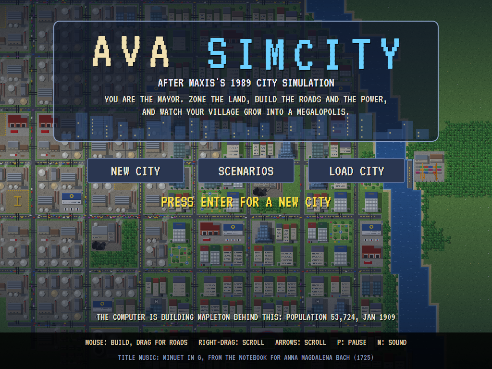
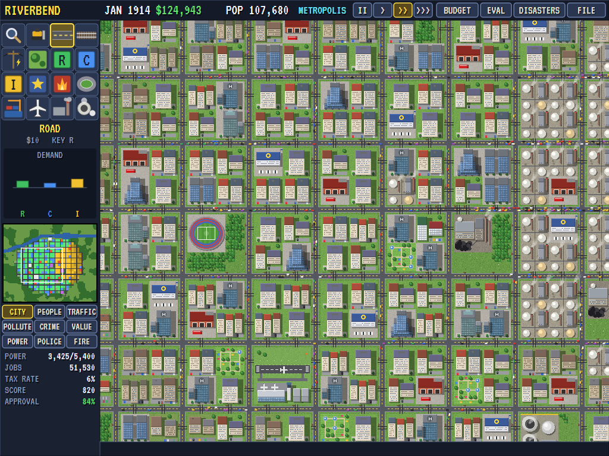
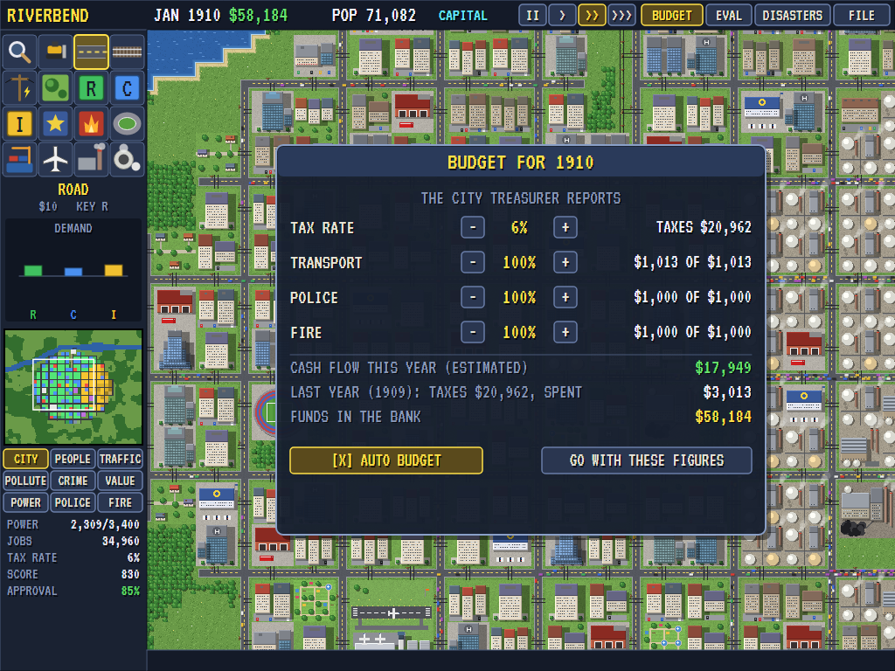
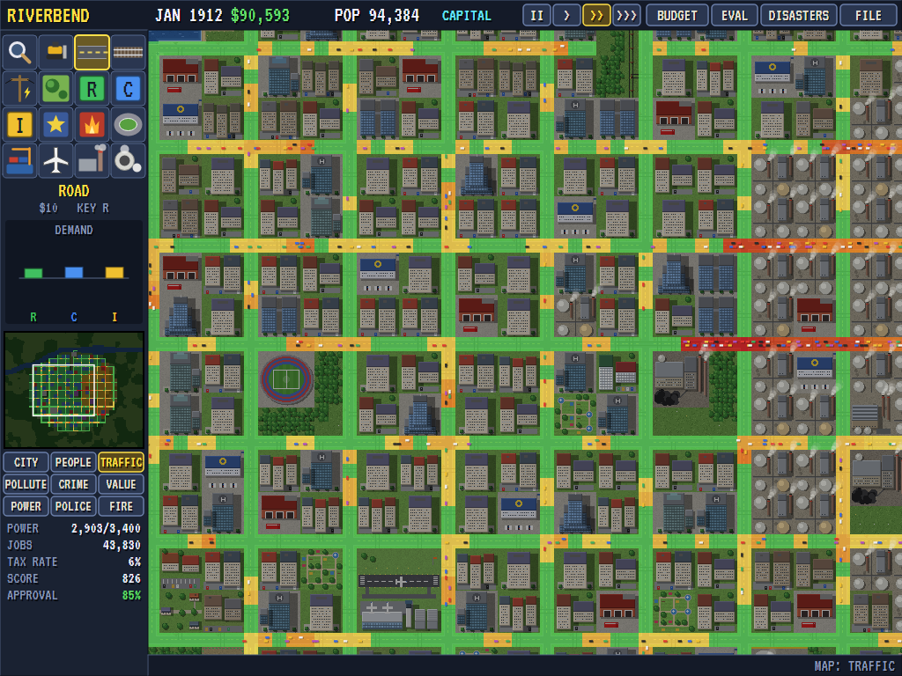
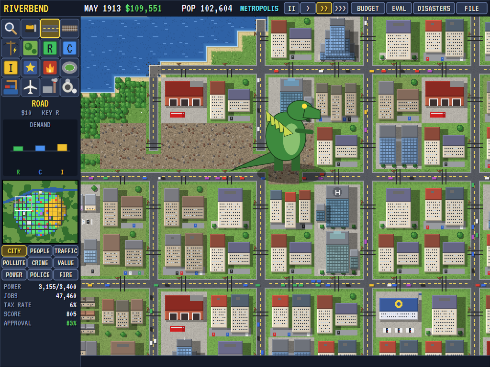
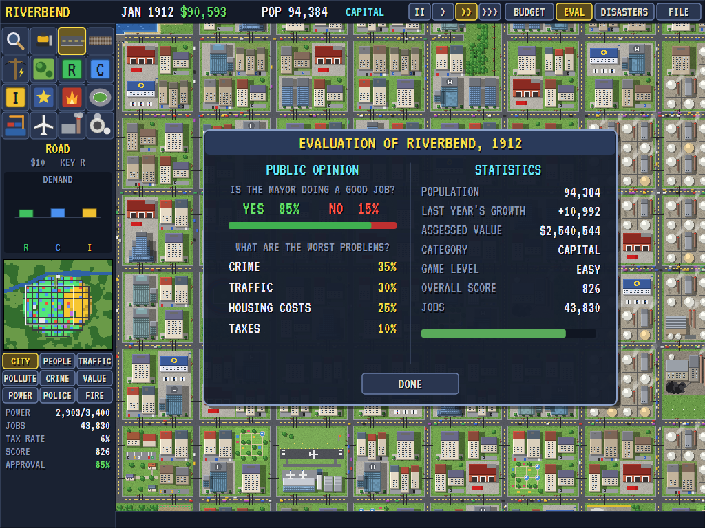
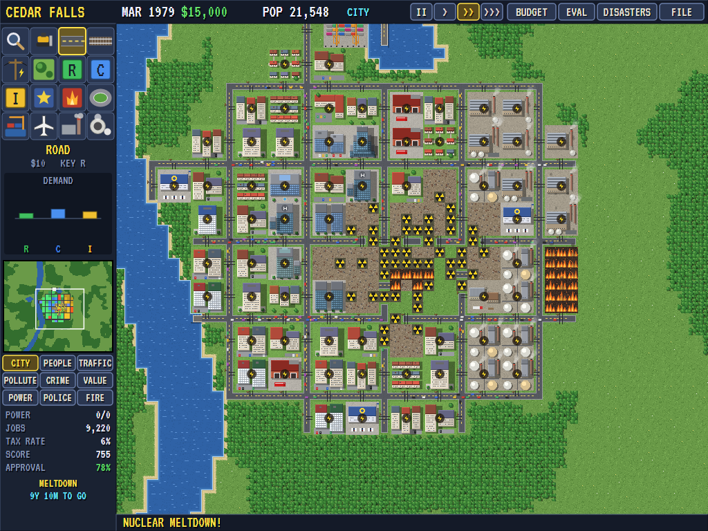

# AVA SimCity

[](https://github.com/Harlock123/AVASimCity/actions/workflows/build.yml)

A city-building simulation in the style of Maxis's 1989 **SimCity**, built with .NET 10 and Avalonia UI. You are
the mayor of a patch of empty land, 120 tiles by 100, with a river or a coast and woods on it. Build a power plant,
zone land for homes, shops and industry, and join it all up with roads, rails and power lines; the people move in
and the zones grow, from houses to apartment towers, from corner shops to skyscrapers, from sheds to refineries,
for as long as there's work, power, a way to get about and nothing too awful about the neighbourhood. Keep the
budget straight, keep the people happy, and see your village become a megalopolis, unless a monster eats it first.

## Features

- **The land:** every new map is different: a coast along a side or two, a river winding across, a lake or two,
  and woods in clumps. Pick the land, the name and the difficulty (easy $20,000, medium $10,000, hard $5,000) in
  the new-city window, and start in January 1900.
- **The tools:** bulldozer, road, rail, power line, park; residential, commercial and industrial zones (three by
  three); police and fire stations (three by three); a stadium, a seaport, coal and nuclear power plants (four by
  four) and an airport (six by six); and the query tool, which tells you about any tile. Roads, rails and power
  lines are drawn by dragging, join up with their neighbours, cross one another two at a time, and go over water
  as bridges at a higher price. Trees and rubble are cleared as you build.
- **Power** flows from every plant along the power lines and from zone to touching zone, each zone taking its
  share, until the plant's capacity runs out (700 for coal, 2,000 for nuclear): past that it's a brownout. A zone
  without power flashes a lightning bolt and won't grow.
- **Traffic:** every month each zone sends its people along the roads (and the railways) to where they want to
  go: homes to jobs, shops and industry to homes. A zone with no road, or nowhere it can get to, declines. The
  trips leave traffic on every road they use; cars and trains run on the busy ones, and a road that's jammed holds
  back the zones that use it and pollutes the air round it.
- **The maps:** every month the city works out its traffic, where its people are, its pollution (industry, the
  coal plant, ports, traffic; parks and trees clean the air a little), its land value (highest near the middle of
  town, by the water and the parks, lower for pollution and crime), crime (where people crowd onto poor land and
  the police don't reach) and the reach of the police and fire stations (less if they're short of money or power).
  Lay any of them over the map, or the power grid.
- **Growth:** a zone grows a level or falls back one each month by the demand for its kind and how pleasant its
  land is. Homes go from a few houses to a ring of eight, to low-rise flats, apartment blocks and towers; shops
  to a shopping centre, offices and a skyscraper with a helipad on top; industry to factories with smoking
  chimneys and then a refinery. Rich and poor neighbourhoods look different, and most levels come in several looks.
- **Demand:** people come where there are jobs, shops come where there are people, and industry sells to the
  outside world and needs workers; the RCI meter shows the three. High taxes cool all three. A city of 30,000
  wants a stadium, its industry a seaport, its commerce an airport, and won't grow past them without.
- **The budget:** at the end of each year the taxes come in (from the people and the jobs, more where the land is
  worth more) and the roads, police and fire department are paid what you fund them. Set the tax rate and the
  three fundings in the budget window, or let it settle itself. Roads you won't pay for fall to rubble.
- **The evaluation:** the people's opinion of the mayor, the worst problems they name (crime, pollution, housing
  costs, taxes, traffic, unemployment, fires), the population and its growth, the assessed value, the city's
  class (village, town, city, capital, metropolis, megalopolis) and the mayor's score out of 1,000.
- **Disasters:** fire (which spreads through buildings and woods, and burns out sooner where the fire department
  reaches), flood, tornado, earthquake, a monster making for the worst pollution, a plane crash and a nuclear
  meltdown that leaves the land round the plant radioactive for good. They come at random (more often on the
  harder levels) unless you turn them off, or call any of them down from the disasters window.
- **Five scenarios,** each a ready-built city in trouble with a goal and a few years to meet it: **Haverford**
  (1961), where the river is about to break its banks; **New Amstel** (1975), a capital in gridlock; **Port Sable**
  (1988), a harbour town with no police and a crime wave; **Cedar Falls** (1979), whose nuclear plant is about to
  melt down; and **Bayport** (1957), where something big has been seen in the bay.
- **Speeds and files:** pause, slow, normal and fast. Save cities to six slots and load them again.
- **The demonstration:** behind the title, the computer mayor builds a city of its own: a grid of blocks, industry
  to one side, shops in the middle, homes and parks all round, a power plant first and another before the power
  runs short, police and fire stations where they're needed, then the stadium, the seaport and the airport. It
  passes 100,000 people in about fifteen years.

## Screenshots

| The title | A grown city | The budget |
|:---------:|:------------:|:----------:|
|  |  |  |
| The computer mayor at work behind it. | A metropolis of 100,000. | The year's taxes and services. |

| The traffic map | A monster | The evaluation |
|:---------------:|:---------:|:--------------:|
|  |  |  |
| Busy roads in red. | Up from the river, making for the factories. | What the people think. |

| A scenario |
|:----------:|
|  |
| Cedar Falls, 1979: the meltdown. |

The screenshots are made by the tests, which play the game in a real (headless) window; see
[Tests](#tests).

## Download and run

Ready-to-run builds for Windows, macOS and Linux, on both Intel/AMD and ARM, are on the
[Releases page](https://github.com/Harlock123/AVASimCity/releases/tag/latest). **Latest build** is
rebuilt on every push to `main`. Each download is one self-contained executable: no .NET install is
needed.

| Platform | Archive |
|---|---|
| Windows | `AVASimCity-win-x64.zip`, `AVASimCity-win-x86.zip`, `AVASimCity-win-arm64.zip` |
| macOS | `AVASimCity-osx-arm64.tar.gz` (Apple silicon), `AVASimCity-osx-x64.tar.gz` (Intel) |
| Linux | `AVASimCity-linux-x64.tar.gz`, `AVASimCity-linux-arm64.tar.gz`, `AVASimCity-linux-arm.tar.gz` |

```bash
tar -xzf AVASimCity-linux-x64.tar.gz     # or linux-arm64, linux-arm, osx-arm64, osx-x64
./AVASimCity
```

On Windows, unzip and run `AVASimCity.exe`. On macOS, if Gatekeeper refuses to open it, run
`xattr -d com.apple.quarantine AVASimCity` once. Run with `--no-audio` for silence.

**Sound** comes through OpenAL Soft, built in for every platform. In a virtual machine the game
detects it and uses a larger audio buffer, so the sound doesn't break up.

## Controls

| Action | Keyboard | Mouse |
|---|---|---|
| A new city | Enter on the title | NEW CITY on the title, or FILE |
| Choose a tool | Q query, B bulldozer, R road, T rail, L power line, K park, 1 residential, 2 commercial, 3 industrial, 4 police, 5 fire station, 6 stadium, 7 seaport, 8 airport, 9 coal, 0 nuclear | Click it in the palette |
| Use the tool | | Left button on the map; drag for roads, rails, power lines, parks and the bulldozer |
| Scroll the map | Arrows or WASD | Right-drag the map, or click the mini-map |
| Zoom | Z | Mouse wheel |
| Map overlays | O (next) | The buttons under the mini-map |
| Pause | P or Space | The speed buttons along the top |
| Slower / faster | - / + | |
| Budget, evaluation, disasters | F2, F3, F4 | BUDGET, EVAL, DISASTERS |
| Save, load | F5, F6 (then 1 to 6 for the slot) | FILE |
| Close a window | Esc or Enter | Right-click |
| Sound on/off | M | |
| Screenshot | Ctrl+S (to your Pictures folder) | |

The cursor shows where a building would go and what it costs: white where it fits, red where it doesn't. In the
new-city window, type the city's name.

## Tests

```bash
dotnet test AVASimCity.slnx
```

The game runs in fixed 60 Hz steps, so it plays the same at any frame rate. Everything that changes lives in
one world that can be copied, saved and loaded. The tests check:

- **The tools:** prices, bridges and running out of money; zones only on clear land, trees and rubble cleared,
  the seaport on the water's edge; crossings two at a time; the bulldozer, and what it can't clear.
- **Power:** the flood fill from the plants along power lines and touching zones and no further; a cut line;
  a plant's capacity and the brownout past it; a second plant.
- **Growth:** a zone with power and a road grows; without power, or without a road, it stays empty; a grown zone
  that loses its power declines; bigger buildings for more people.
- **Traffic:** trips along the roads to where people want to go, leaving traffic on the way; no road, and nowhere
  to get to; jams, and the pollution they make.
- **The maps:** industry and the coal plant polluting, and pollution bringing land value down; land worth more
  in the middle, by the water and the parks; crime where people crowd onto poor land, and a police station
  bringing it down.
- **Demand, money and opinion:** jobs bring people, people bring shops, taxes cool them all; the year's taxes and
  the services paid as funded; unfunded roads falling apart; approval lost to high taxes; the city's classes.
- **Disasters:** fire spreading and burning out, and a fire station putting it out sooner; a building burning down
  whole; a flood rising and going down; a tornado and a monster wrecking their way; an earthquake; a plane crash;
  a meltdown only with a nuclear plant, leaving radiation for good; random disasters only when they're on.
- **The land, the computer mayor and the scenarios:** the same seed making the same land; the computer mayor
  building a powered, growing city and building again after an earthquake; every scenario starting built up with
  its goal and its trouble on time, and won or lost when its time is up.
- **The files and the game:** a saved city loading just as it was and going on the same; a copied city going on as
  the original; the title, its demonstration and the new-city window; dragging roads, clicking zones and the query
  tool; the mouse choosing a tool from the palette and building with it on the screen; the speeds, the pause and
  windows stopping the clock; the budget window at the year's end; saving and loading slots; disasters from the
  window; the keys scrolling the map; a sound file for every sound.

`tests/AVASimCity.Tests/PilotProbe.cs` reports how the computer mayor gets on, year by year, for tuning
(`SIMCITY_PROBE=1`, `SIMCITY_YEARS=30`, `SIMCITY_SEED=7`; `SIMCITY_PROBE=disasters` with random disasters on).
Its cities pass 100,000 people in fifteen to twenty years, and thirty years take a few seconds.

The screenshot tests draw the real screen in a headless window. To refresh the README's pictures:

```bash
SIMCITY_SHOTS=$PWD/Images dotnet test tests/AVASimCity.Tests --filter ScreenshotTests
```

## Building

```bash
dotnet build AVASimCity.slnx
dotnet run --project src/AVASimCity
```

Needs the .NET 10 SDK. The sounds and the title music are made by `tools/make_sounds.py` (standard-library
Python): `python3 tools/make_sounds.py` rewrites `src/AVASimCity/Sounds`.

## Project structure

```
AVASimCity/
├── AVASimCity.slnx
├── src/AVASimCity/
│   ├── Engine/
│   │   ├── GameEngine.cs        # States, the tool in hand, the view, the windows, speeds, files, the demonstration
│   │   ├── Sim.cs               # The rules: tools, power, trips and traffic, growth, the maps, demand, money,
│   │   │                        # the evaluation, disasters
│   │   ├── World.cs             # The land, the zones, the maps and the money, kept so they can be copied
│   │   ├── Terrain.cs           # New land: coasts, rivers, lakes and woods
│   │   ├── Pilot.cs             # The computer mayor
│   │   ├── Scenarios.cs         # The five cities in trouble
│   │   ├── CityFile.cs          # Saving and loading cities
│   │   ├── InputHandler.cs      # The keys held
│   │   └── SoundManager.cs      # Effects and the title tune through OpenAL
│   ├── Audio/                   # The OpenAL engine (from the author's AVABand)
│   ├── Views/
│   │   ├── TileArt.cs, Pix.cs   # Every tile and building, drawn pixel by pixel
│   │   ├── MapPainter.cs        # The map as one picture, redrawn tile by tile as it changes; the mini-map
│   │   └── GameCanvas*.cs       # The screen: the map and its life, the palette, the windows, the title
│   └── Sounds/                  # The synthesised effects and music
├── tests/AVASimCity.Tests/      # Gameplay and screenshot tests
├── tools/make_sounds.py
└── Images/                      # Screenshots
```

## About and licence

AVA SimCity © 2026 Lonnie Watson, under the [MIT License](LICENSE).

*SimCity* © 1989 Maxis; *SimCity* is a trademark of Electronic Arts. AVA SimCity is an independent, unofficial
game in its style. Its graphics, sounds and code are its own; nothing is taken from the original game's program,
graphics or sound (nor from the open-source Micropolis). It is not affiliated with or endorsed by Electronic Arts,
Maxis or any other rights holder. The title music is the Minuet in G major, BWV Anh. 114, from the Notebook for
Anna Magdalena Bach (1725), attributed to Christian Petzold, which is in the public domain.
